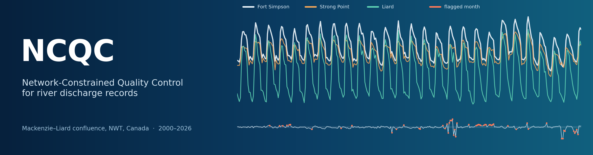
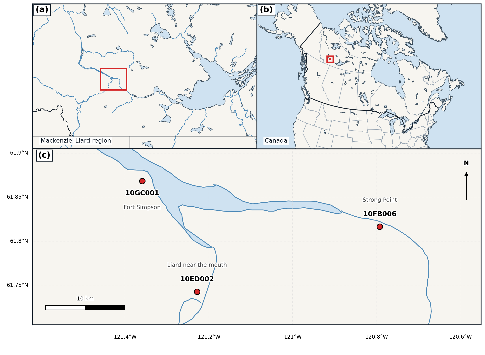

<p align="center">
  
</p>

# NCQC – Network-Constrained Quality Control

Code and data for the paper **"A Network-Constrained Quality Control Framework for Identifying Reliability Concerns in River Discharge Records"** (Razavi, in review).

Published discharge is usually treated as if it were measured exactly. In practice, every value passes through a rating curve, and often through shifts, overrides and an approval step as well, and a lot can go wrong along the way that station-level checks never see. NCQC looks at the problem from the network side. If you have gauges upstream and downstream of a confluence, the water has to add up. When it doesn't, something is off, and the pattern of the mismatch tells you a fair amount about what and where.

This repository runs the whole analysis for three Water Survey of Canada gauges at the Mackenzie–Liard confluence (Northwest Territories), 2000–2026. Every number in the paper can be regenerated from the files here.

<p align="center">
  
</p>
<p align="center"><sub><b>Figure 1.</b> The three-gauge control volume: Mackenzie River at Strong Point (10FB006), Liard River near the mouth (10ED002) and Mackenzie River at Fort Simpson (10GC001).</sub></p>

## What NCQC does

The framework is a chain of seven tests, T0–T6:

| Test | What it checks |
|---|---|
| **T0** Provenance | Significant-digit count of reported values; picks up changes in record status (approved vs provisional) without needing metadata |
| **T1** Admissibility | Positive flows; downstream discharge not below either upstream contribution |
| **T2** Regime | Ice-affected / transition / open-water months from MODIS NDVI |
| **T3** Closure | Regime-specific tolerance on the mass-balance residual, giving the standardized statistic *Z*ₜ |
| **T4** Attribution | Temporal and spatial scores that point to the most likely station |
| **T5** Episodes | Groups flagged months and runs a CUSUM to catch slow drifts |
| **T6** Independence | Flags periods where closure is *too* good to count as independent evidence |

The results are summarized as six network flags (N0–N5) meant to sit alongside the agency's own quality symbols.

Some headline results from the Mackenzie–Liard application:

- Closure is tight overall (r² = 0.9953, robust relative scale 1.67%). Even so, 54 of 319 months (16.9%) are flagged, grouped into 22 episodes.
- In 4327 synthetic error-injection trials, 5% and 10% sustained biases are detected with probability 0.72 and 0.89. A conventional station-level baseline running at the same false-alarm rate almost never catches them.
- The switch from approved to provisional records in January 2025 shows up on its own in the digit-precision test.
- Winter closure during 2020–2024 is unusually close (robust scale 0.20% vs 1.46% before). T6 treats this as a warning sign rather than proof of accuracy.

## Repository layout

```
├── data/
│   ├── raw/            station workbooks: WSC discharge + ERA5-Land + MODIS NDVI, monthly
│   └── processed/      everything the scripts write (tables and summary numbers)
├── figures/            Figures 1–9 as used in the paper
├── src/
│   ├── ncqc.py                         the algorithm (T0–T6); imported by the scripts
│   ├── paths.py                        folder layout
│   ├── 01_load_data.py                 workbooks  -> merged.csv
│   ├── 03_error_injection.py           synthetic error injection -> injection.csv
│   ├── 04_make_figures.py              Figures 1–9, summary.json, episodes.csv
│   ├── 05_sensitivity_and_baselines.py station-level baseline and sensitivity checks
│   └── optional/gee_fig1a_sentinel2.js Earth Engine export of a satellite basemap (not used by default)
└── docs/               README banner and the script that draws it
```

There is no `02_` script; `ncqc.py` is step 2 and is imported, not run.

## Running it

You need Python 3.10 or newer. Then:

```bash
pip install -r requirements.txt
bash run_all.sh
```

or step by step, from the repository root:

```bash
python src/01_load_data.py                  # ~1 s
python src/03_error_injection.py            # ~4 min
python src/04_make_figures.py               # ~30 s
python src/05_sensitivity_and_baselines.py  # ~6–10 min
```

The error-injection steps use a fixed random seed (`numpy.random.default_rng(7)`), so the runs are reproducible. With the versions in `requirements.txt`, `merged.csv`, `injection.csv`, `episodes.csv` and `summary.json` come out byte-for-byte identical to the files committed here. Figure 1 is drawn from the coastline and boundary data bundled with `basemap`, so it needs no internet connection.

## Data

The three files in `data/raw/` hold monthly values for January 2000 – July 2026:

- **Discharge** – Water Survey of Canada (Environment and Climate Change Canada). Approved records for 2000–2024 come from the National Water Data Archive (HYDAT, release of 17 July 2026). Provisional values for 2025–2026 come from the Wateroffice service and are averaged from provisional daily means.
- **ERA5-Land** surface runoff and total precipitation at the gauge grid cell (Muñoz-Sabater et al., 2021).
- **MODIS NDVI** (MOD13Q1, 250 m, 16-day) at the gauge pixel, averaged to calendar months (Didan, 2015).

ERA5-Land and MODIS were extracted with Google Earth Engine. Provisional WSC values can still be revised, so if you download them again later you may get slightly different numbers for 2025–2026. See `data/README.md` for column definitions and source terms.

## Citing

If you use the code or data, please cite the Zenodo record (see `CITATION.cff`; the DOI badge will appear here once the record is published) and the paper once it is out.

## License

- Code (`src/`, `docs/make_banner.py`): MIT, see [`LICENSE`](LICENSE).
- Data and figures (`data/`, `figures/`, `docs/banner.png`): CC BY 4.0, see [`LICENSE-DATA.md`](LICENSE-DATA.md). The underlying WSC, ERA5-Land and MODIS data remain under their providers' terms, and those terms are summarized in `data/README.md`.

## Contact

Hooman Razavi. Questions and bug reports are welcome through GitHub issues.
